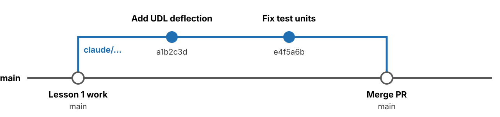

<style>
section {
  --nav: "Overview\A Concepts\A Specify\A Setup\A Generate\A Adjudicate\A Pitfalls\A GenAI Use\A Your Repo\A Teaching\A Review";
}
section.overview   { --i: 0;  --label: "Overview"; }
section.concepts   { --i: 1;  --label: "Concepts"; }
section.specify    { --i: 2;  --label: "Specify"; }
section.setup      { --i: 3;  --label: "Setup"; }
section.generate   { --i: 4;  --label: "Generate"; }
section.adjudicate { --i: 5;  --label: "Adjudicate"; }
section.pitfalls   { --i: 6;  --label: "Pitfalls"; }
section.genai      { --i: 7;  --label: "GenAI Use"; }
section.yourrepo   { --i: 8;  --label: "Your Repo"; }
section.teaching   { --i: 9;  --label: "Teaching"; }
section.review     { --i: 10; --label: "Review"; }
</style>

<!-- _class: title -->
<!-- _paginate: false -->
<!-- _header: "" -->
<!-- _footer: USAFA Instructor Short Course -->

# Agentic AI for Engineering

## Lesson 2

### Introduction to Agentic AI for Coding

#### Hands-on with Claude Code on the web

Specify, generate, and verify changes with a coding agent

<!--
Lesson 2 connects the repo from Lesson 1 to a coding agent. The goal is a repeatable loop: specify a verifiable change, let the agent generate it on a branch, and verify it yourself before it reaches main. Everything we do today with beam-calc applies to your own course code in Exercise 7.
-->

---

<!-- _class: overview -->

# Lesson Objectives

By the end of this lesson you can:

1. Explain how a coding agent differs from a chat LLM, and how your role changes
2. Give an agent your project's context with CLAUDE.md (and AGENTS.md)
3. Specify a change as a verifiable requirement, and get a plan before any code
4. Review an agent's diff and pull request, then verify the result yourself
5. Document GenAI use, and plan how cadets will use agents in your course

**Agenda (50 min)**

<div class="flow" style="gap:8px">
<div class="dark" style="flex:3"><b>0–15 min</b>Concepts</div>
<div class="blue" style="flex:6"><b>15–45 min</b>Guided exercises in Claude Code</div>
<div style="flex:1;background:#595959;color:#fff"><b>45–50</b>Review</div>
</div>

<!--
Lesson 1 gave everyone a repo on GitHub and the habit of working through branches and pull requests. This lesson puts a coding agent on the other side of that loop. The worked example continues with beam-calc so nobody is debugging unfamiliar code; the last exercise moves to each instructor's own project. Emphasize objective 4: the engineer, not the agent, owns verification.
-->

---

<!-- _class: overview -->

# Prerequisites

Complete before class:

| | |
|---|---|
| Lesson 1 repo | Your private copy of **beam-calc** on GitHub, cloned with GitHub Desktop. |
| Agent account | Claude Pro or higher for Claude Code on the web. Use the account type your organization directs. Other tools: see Agent Tool Options. |
| GitHub Desktop + VS Code | Installed and signed in (Lesson 1). |
| MATLAB (optional) | To run the tests yourself. The agent's cloud sandbox has no MATLAB. |
| Your own project | The repo from Lesson 1's Agent-Ready Checklist, for Exercise 7. |

<p class="muted">Follow current USAFA guidance on GenAI tools and data handling before you connect a repo to an agent.</p>

<!--
The agent account is the usual blocker; sort it out before class. Use whatever account type your organization directs. MATLAB is optional but strongly recommended: the agent cannot run MATLAB in its cloud sandbox, so the instructor is the only one who can execute the tests. That gap is the point of the Adjudicate step.
-->

---

<!-- _class: concepts -->

# Chat LLM vs. Coding Agent

<div class="flow">
<div><b style="color:#1f6fb2">Chat LLM</b>Answers in text. You copy, paste, and debug.</div>
<div><b style="color:#1f6fb2">LLM + tools</b>Writes and runs code in the chat. You still integrate it.</div>
<div class="dark"><b>Coding agent</b>Reads your repo, edits files, runs commands, commits. You review.</div>
</div>

| | Chat LLM (copy/paste) | Coding agent (Claude Code) |
|---|---|---|
| Sees your code | Only what you paste in | Reads the whole repo itself |
| Edits code | You copy, paste, and merge by hand | Edits files and commits them to a branch |
| Runs commands | No | Yes, in a cloud sandbox (search, scripts) |
| Project rules | Re-explained in every chat | Written once in CLAUDE.md, read every session |
| Your role | Integrator and debugger | Specifier, reviewer, and tester |

**An agent does more work per prompt. Each prompt needs a clearer specification, and each result needs a closer review.**

<!--
Most instructors have used chat LLMs. The shift is that the agent works directly in the repo, so the human job moves from integrating code to specifying and verifying it. That is the same shift we ask of cadets when they move from writing every line to engineering a system.
-->

---

<!-- _class: concepts -->

# The Method

<div class="flow center">
<div class="dark"><b>SPECIFY</b>Verifiable requirements</div>
<div class="blue"><b>GENERATE</b>Agent proposes a design</div>
<div class="blue"><b>IMPLEMENT</b>Trusted tools make it real</div>
<div class="dark"><b>ADJUDICATE</b>Engineer owns the call</div>
</div>
<p class="muted small" style="text-align:right;margin-top:-14px">↺ <b>ITERATE</b> from Adjudicate back to Generate</p>

The five workflow steps, for any coding agent:

1. Put your project in a GitHub repo <span class="muted">(done in Lesson 1)</span>
2. Open a session in Claude Code, Codex, or another coding agent
3. Connect your repo to the session, with a context file (CLAUDE.md)
4. Work with the agent to generate commits on a branch
5. Adjudicate the agent's work yourself, and iterate

<!--
Specify, Generate, Implement, Adjudicate, then Iterate. The agent is good at Generate. Specify and Adjudicate stay with the engineer; Implement means trusted tools (MATLAB, the compiler, test suites, hardware) turn the proposal into evidence. The five steps are the mechanics; every remaining slide maps to one of them.
-->

---

<!-- _class: concepts -->

# Agent Tool Options

| Tool | Where it runs | Access | Context file |
|---|---|---|---|
| Claude Code on the web <span class="muted">(this lesson)</span> | Cloud sandbox, working from your GitHub repo | Claude Pro plan or higher | CLAUDE.md |
| OpenAI Codex | Cloud tasks from your GitHub repo; also an app, CLI, and VS Code extension | ChatGPT plans; limits vary by plan | AGENTS.md |
| GitHub Copilot agent mode | VS Code on your laptop; coding agent on GitHub | Copilot Free (limited) or paid plans | .github/ copilot-instructions.md |

1. The five workflow steps are the same for every tool.
2. With a local agent, Exercises 2–3 become "open the repo folder in VS Code." The agent edits your working copy; you review and commit in GitHub Desktop.

<p class="muted"><em>Plans and limits change often. Check each tool's current plan page, and use the tools your organization approves.</em></p>

<!--
Claude Code on the web is the worked example because it runs entirely from a GitHub repo, which is what Lesson 1 set up. The method transfers to any agent. Codex reads AGENTS.md, which is why the beam-calc repo already has one; CLAUDE.md can import it. Verify current plans before recommending a tool to colleagues or cadets.
-->

---

<!-- _class: specify -->

# Example: Distributed Load

<span class="chip navy">SPECIFY</span>

<div class="cols wide-left">
<div>

<p class="label">STARTING POINT</p>

Your **beam-calc** repo from Lesson 1. `beam.m` computes cantilever tip deflection for a point load; `tests/testBeam.m` checks it.

<p class="label">REQUIREMENT</p>

**beam-calc shall compute the tip deflection for a uniformly distributed load w (N/m) with a function tipDeflectionUDL(w, L, E, I), and beam.m shall print it below the point-load result.**

<p class="label">VERIFICATION</p>

Test: a new case in `tests/testBeam.m` matches the hand calculation within 0.1%, and `runtests('tests')` passes in MATLAB. The point-load result is unchanged.

</div>
<div>
<div class="card">

### Theory

Point load: &nbsp; δ = P L³ / (3 E I)

**Distributed: &nbsp; δ = w L⁴ / (8 E I)**

<p class="muted small">Same beam, P = wL: the distributed result is 3/8 of the point-load result.</p>

</div>

```matlab
% Hand check
w = 1000;  L = 2.0;
E = 200e9;
I = 0.05*0.10^3/12;
% δ = 2.40 mm
```

</div>
</div>

<!--
One small feature carried through every exercise. The requirement is written so it can be verified before any code exists: a named function, units, and a test with a tolerance. The hand check uses the Lesson 1 section (50 × 100 mm steel, L = 2 m), so it does not depend on what instructors changed in beam.m during Lesson 1. Point out the 3/8 ratio: an independent sanity check the agent did not write.
-->

---

<!-- _class: setup -->

# Exercise 1: Add CLAUDE.md

<div class="cols">
<div>

```markdown
# beam-calc
@AGENTS.md

## About me
- Instructor. Fluent in MATLAB,
  new to coding agents. Explain
  each change before coding.
- Prefer simple, readable MATLAB.

## Environment
- You can't run MATLAB in your
  sandbox. List the checks I
  must run myself.

## Rules
- One function per file.
- Never change an existing
  result or test without asking.
```

</div>
<div>

<span class="chip">EXERCISE</span>

1. In VS Code, create **CLAUDE.md** at the repo root. Adapt the example to you.
2. Line 2, **@AGENTS.md**, imports the rules you wrote in Lesson 1. One set of rules for every agent.
3. Commit to main: _Add CLAUDE.md_. **Push origin**.

<p class="muted small">Claude Code reads CLAUDE.md at the start of every session. Include what a new colleague would need.</p>
<p class="muted small">Keep it short. Add a rule each time the agent repeats a mistake.</p>

</div>
</div>

<!--
CLAUDE.md is the most effective single thing you can do to improve agent output. It is plain Markdown at the repo root. The @AGENTS.md line pulls in the Lesson 1 file, so Codex and Claude Code follow the same conventions without duplicating them. Alternative: type /init in a session and the agent drafts CLAUDE.md by scanning the repo; then correct it and add what it can't see, like the fact that it can't run MATLAB. About me sets the explanation level; in any prompt you can also ask it to explain like you are new to Git.
-->

---

<!-- _class: setup -->

# Exercise 2: Open a Session

<div class="flow center lines">
<div class="outline"><b>Claude Code</b>cloud sandbox</div>
<div class="outline"><b>GitHub repo</b>shared source</div>
<div class="outline"><b>Your laptop</b>Desktop + MATLAB</div>
</div>

<p class="muted">The session can read and change your repo. It cannot reach your laptop, your MATLAB license, or any file outside the repo.</p>

<span class="chip">EXERCISE</span>

1. Go to **claude.ai/code** and sign in.
2. Connect GitHub when prompted. Install the Claude GitHub App on **your beam-calc repo only**.
3. Accept the **Default** environment.
4. New session: select **beam-calc** and the **main** branch. The session clones the repo and loads CLAUDE.md.

<!--
Emphasize the architecture: the agent never touches the laptop. GitHub is the hand-off point between the cloud session and your machine, which is why Lesson 1 spent so long on push, fetch, and pull. Grant the GitHub App access to selected repositories only, not your whole account.
-->

---

<!-- _class: setup -->

# Exercise 3: Orient the Agent

<span class="chip">EXERCISE</span>

Send an orientation prompt before asking for any change:

<div class="bubble you">

Read CLAUDE.md, AGENTS.md, beam.m, and tests/testBeam.m. Summarize what the code computes, its units, and how it is tested. Don't change any files.

</div>
<div class="bubble agent">

beam.m computes the tip deflection of a cantilever under a point load, δ = PL³/(3EI), in SI units, and prints it in mm. tests/testBeam.m checks that result; run it with runtests('tests'). I can't run MATLAB here, so I haven't executed the tests.

</div>

**Check the summary against the code. If the agent misunderstands the code now, its changes will be wrong too.**

<!--
The orientation prompt costs one message and tells you whether the agent understands the code. A good answer names the formula, the units, the test, and its own limits. If the summary is wrong, fix CLAUDE.md before going further.
-->

---

<!-- _class: generate -->

# Exercise 4: Plan Before Code

<span class="chip">EXERCISE</span>

<div class="cols">
<div class="bubble you">

Implement the requirement: add tipDeflectionUDL(w, L, E, I), δ = wL⁴/(8EI), print it from beam.m, and add a test against the hand calculation (2.40 mm).

**Don't write code yet. Give me a plan: files and functions you'll change, and any questions.**

</div>
<div class="bubble agent">

Plan:
1. New file tipDeflectionUDL.m.
2. beam.m: add w = 1000 N/m; print the result after the point load.
3. tests/testBeam.m: add testUDLHandCalc.

<span class="ask">Question: does w act over the full length?</span>

</div>
</div>

<div class="bubble you">

Full length. Plan approved. Implement it and commit.

</div>

<p class="muted small">Check the plan for: expected files only · real MATLAB functions · questions answered by you, not guessed.</p>

<!--
Asking for a plan first is cheap and catches wrong assumptions before code is written. Good plans name files, functions, and open questions. The engineer answers the questions; the agent should not guess. Here the load extent is a real modeling decision that belongs to the instructor.
-->

---

<!-- _class: generate -->

# Exercise 5: Review the Diff

<div class="cols wide-left">
<div>

```diff
claude/udl-deflection · 3 files  +12 −0
@@ tipDeflectionUDL.m (new) @@
+function d = tipDeflectionUDL(w, L, E, I)
+% Tip deflection, uniform load w (N/m)
+d = w*L^4/(8*E*I);       % m
+end
@@ beam.m @@
 fprintf('Tip deflection: %.2f mm\n', ...)
+w = 1000;                % N/m, uniform
+dW = tipDeflectionUDL(w, L, E, I);
+fprintf('UDL deflection: %.2f mm\n', ...)
@@ tests/testBeam.m @@
+function testUDLHandCalc(tc)
+I = 0.05*0.10^3/12;
+d = tipDeflectionUDL(1000, 2.0, 200e9, I);
+verifyEqual(tc, d, 2.40e-3, 'RelTol', 1e-3)
+end
```

</div>
<div>

<span class="chip">EXERCISE</span>

1. Read every line. Green **+** lines were added; red **−** lines were removed.
2. Ask about anything unclear: _Why RelTol 1e-3?_
3. Select **Create PR** in the session.

<p class="muted small">You are accountable for every line you merge, as cadets are for every line they submit.</p>

</div>
</div>

<!--
The agent pushes to a new claude/ branch, never directly to main. Walk through the diff line by line. Look hardest at the test: an agent that writes both the code and its test can make them agree with each other and still be wrong. Here the expected value 2.40e-3 m comes from our hand calculation, not from the code. The ... in the fprintf lines is shortened for the slide.
-->

---

<!-- _class: generate -->

# Agent Branches & PRs



<div class="cols">
<div>

### Branch

Each session creates its own claude/… branch and pushes every commit there, including fixes.

main is unchanged until you merge.

</div>
<div>

### Pull request (PR)

1. Select **Create PR** in the session.
2. On GitHub, read **Files changed**.
3. Test the branch yourself (next).
4. Merge only after it passes.

</div>
</div>

<!--
Same branches and pull requests as Lesson 1, with the agent as the other contributor. The agent never commits to main. Each session gets its own branch, and every commit in that session, including fixes, goes there. The pull request is where the review happens, and where the change is merged after the test passes.
-->

---

<!-- _class: adjudicate -->

# Exercise 6: Test It Yourself

<span class="chip">EXERCISE</span>

1. GitHub Desktop: **Fetch origin**, then switch Current branch to **claude/udl-deflection**.
2. MATLAB: open the repo folder. Run `beam`, then `runtests('tests')`.
3. Check the result against your own hand calculation, not the agent's.

<p class="label">PASS CRITERIA (FROM THE REQUIREMENT)</p>

<ul class="check">
<li>All tests pass, including <b>testUDLHandCalc</b>.</li>
<li>Hand check: w = 1000 N/m, L = 2.0 m, steel, 50 × 100 mm → <b>δ = 2.40 mm</b>.</li>
<li>With P = wL, the distributed result is <b>3/8</b> of the point-load result.</li>
<li>The point-load line prints the same value as on main.</li>
</ul>

<div class="banner"><b>Until you run it, the agent's commit is a proposal.</b></div>

<!--
This is the only step that tests the requirement. MATLAB and the test suite are the trusted tools; the hand calculation and the 3/8 ratio are independent checks the agent did not produce. If an instructor has no MATLAB, they can still review the test logic and the hand calculation, but should record the change as unverified.
-->

---

<!-- _class: adjudicate -->

# Iterate & Merge

<span class="chip navy">ITERATE</span>

<div class="cols">
<div>

### If it fails

Report what you observed and paste the output.

<div class="bubble you">

testUDLHandCalc fails: expected 2.4000e-03, got 2.4000e-06. Output below. Find the cause and explain it before changing code.

<span class="muted">[paste MATLAB output]</span>

</div>

<p class="muted">The agent pushes a new commit to the same branch. Fetch, rerun, retest.</p>

</div>
<div>

### If it passes

1. Merge the PR on GitHub.
2. GitHub Desktop: switch to main, **Pull origin**.
3. Start a new session for the next requirement.
4. Add a rule to CLAUDE.md for any mistake the agent made twice.

</div>
</div>

<!--
Failure reports should contain observations and logs, not just 'it doesn't work'. Asking for an explanation before a fix keeps the engineer in the loop and often exposes a wrong assumption (here, a section dimension entered in mm). One requirement per session keeps context small and commits easy to review.
-->

---

<!-- _class: pitfalls -->

# Common Failure Modes

| Failure | beam-calc example | How you catch it |
|---|---|---|
| Wrong formula | w L⁴ / (3 E I): the point-load denominator reused | Hand calc; the 3/8 ratio |
| Unit slip | Section entered in mm in an SI file | Result off by a power of 10 |
| Weakened test | Expected value or tolerance edited until the test passes | Read test diffs line by line |
| Missing toolbox | Calls a function from a toolbox you don't have | Run it; AGENTS.md toolbox rule |
| Scope creep | Unrequested "cleanup" of beam.m | Diff touches lines you didn't expect |
| Unverified claim | "All tests pass" | It can't run MATLAB; you run them |

<!--
Every row is a pattern seen with engineering code. Agents produce plausible code; plausible is not the same as correct. The weakened test is the most dangerous because the green check mark looks like evidence. The independent checks (hand calculation, units, running the suite yourself) are what catch these.
-->

---

<!-- _class: genai -->

# Documenting GenAI Use

Model the documentation you require of cadets. Follow current USAFA and department guidance for your course.

Keep an **AI_LOG.md** in the repo, with one entry per session:

```markdown
## 2026-10-14 · UDL tip deflection
Session:      claude.ai/code link
Prompts:      orientation, plan, implement, fix test units
Agent made:   commits a1b2c3d, e4f5a6b (PR #2)
I decided:    load acts over the full length
Verified:     runtests passes; hand calc 2.40 mm; 3/8 ratio
Issue found:  test section entered in mm on first try
```

<p class="muted">The commit history and PR discussion are also part of the record.</p>

<!--
Instructors who document their own agent use are better placed to set and grade the same expectation for cadets. An AI_LOG.md, one entry per session, records how GenAI contributed and what the human did to evaluate it. Check the current USAFA and department GenAI policy for the exact wording your course requires.
-->

---

<!-- _class: yourrepo -->

# Exercise 7: Your Own Repo

<div class="cols wide-left">
<div>

<span class="chip">EXERCISE</span>

1. Open your Agent-Ready repo from Lesson 1.
2. Write one small requirement **and how you'll verify it**, before opening a session.
3. Add CLAUDE.md, or run **/init** and correct it.
4. Orient → plan → implement.
5. Review the PR and test it yourself. Merge only if it passes.
6. Add an entry to AI_LOG.md.

</div>
<div>
<div class="card small">

### Good first requests

- Add a test for an existing function
- Add input checks with clear errors
- Explain how to run it in the README
- Replace hard-coded values with parameters

</div>
<div class="card small">

### Avoid for now

- "Rewrite the whole project"
- Anything you can't check yourself

</div>
</div>
</div>

<!--
Move from the shared example to each instructor's own project. Coach toward small, checkable requirements; the first session is about learning the loop, not shipping a large feature. Walk the room and look at requirements before people open sessions: a requirement with no verification is the most common problem.
-->

---

<!-- _class: teaching -->

# Cadet Teams & Agents

An agent session belongs to one account; teammates can't join it. The GitHub repo is the team's shared workspace.

<div class="cols">
<div class="card">

<p class="label" style="margin-top:0">OPTION A</p>

### One driver

- One cadet with agent access runs the sessions.
- The others review plans and PRs, and test.
- Rotate the driver each requirement.

</div>
<div class="card">

<p class="label" style="margin-top:0">OPTION B</p>

### Parallel drivers

- Each cadet runs sessions on their own requirement and branch.
- Merge through PRs.
- Don't let two sessions edit the same function.

</div>
</div>

<div class="banner">

**Grade the process:** requirement, plan, PR review, test evidence, AI_LOG.md.
Add every teammate as a repo collaborator. Never share agent account logins.

</div>

<!--
When you bring this to a course, decide the team model up front. A session belongs to one account; teammates cannot join it live, so the repo is where collaboration happens. Grading the artifacts of the process (requirement, plan, review, verification, log) rewards the engineering judgment we care about rather than the volume of generated code.
-->

---

<!-- _class: review -->

# Troubleshooting

| Symptom | Fix |
|---|---|
| Repo missing from the session list | Grant the Claude GitHub App access to that repo (GitHub › Settings › Applications). |
| Agent ignores your rules | Check CLAUDE.md is at the repo root on the branch the session uses. Shorten it. |
| Agent's branch not in GitHub Desktop | Fetch origin first, then open the Current branch menu. |
| Agent says tests pass | It can't run MATLAB. Run runtests('tests') yourself. |
| PR changes lines you didn't ask for | Comment on those lines in the PR, or ask the agent to revert them. |
| Answers drift in a long session | Merge what works, then start a new session per requirement. |

<!--
These are the problems instructors hit most often in a first session. Most come back to two ideas: GitHub is the hand-off point, so fetch before you look for agent work; and the agent cannot run MATLAB, so verification is always yours.
-->

---

<!-- _class: review -->

# Quick Reference

| To… | Prompt or action |
|---|---|
| Orient the agent | "Read CLAUDE.md and … Summarize … Don't change any files." |
| Get a plan | "Don't write code yet. Give me a plan: files, functions, and questions." |
| Approve the plan | "Plan approved. Implement it and commit." |
| Report a failure | "Observed …; expected …. Output below. Find the cause and explain it before changing code." |
| Draft CLAUDE.md | /init in a session, then correct it |
| Open a PR | Create PR in the session |
| Test the agent's branch | Fetch origin › Current branch › claude/… |
| Finish | Merge the PR, switch to main, Pull origin |

<!--
A one-page summary of the prompts and actions from today. Suggest instructors keep it open during Exercise 7 and when they first use an agent on their own.
-->

---

<!-- _class: review -->

# Knowledge Check

1. What can a coding agent do that a chat LLM can't, and how does that change your role?
2. What belongs in CLAUDE.md, and how does it relate to AGENTS.md?
3. Why ask for a plan before any code is written?
4. The agent reports "All tests pass." What do you do?
5. A PR changes a test's expected value so the test passes. Merge it?

<div class="banner" style="margin-top:40px">

**Next: Lesson 3** · Agentic AI for course app development using GitHub Pages.

</div>

<!--
Expected answers. 1: it reads the repo, edits files, runs commands, and commits; you move from integrator to specifier, reviewer, and tester. 2: project context, environment limits, and rules; CLAUDE.md can import AGENTS.md so every agent shares one set of rules. 3: it catches wrong assumptions and open questions cheaply, before code exists. 4: verify it yourself; the agent cannot run MATLAB. 5: not without an independent reason the old value was wrong; a test edited to pass is not evidence.
-->
